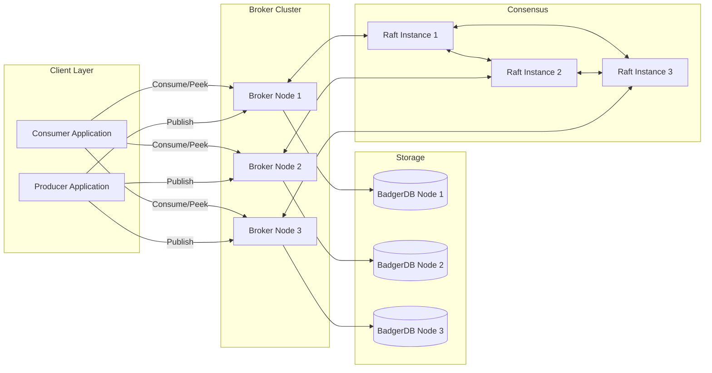
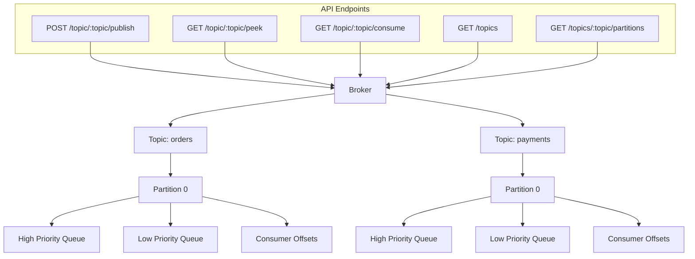
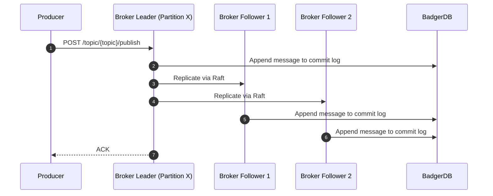
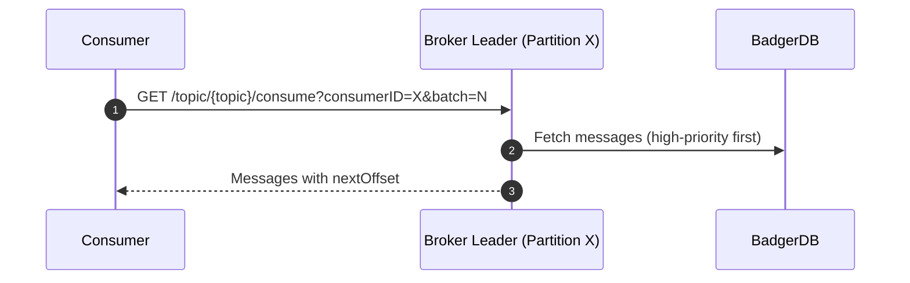

# FalconQ – Distributed Message Queue with Priority-Based Messaging


## Overview

FalconQ is a high-performance distributed message queue designed and implemented in Go. This project addresses the critical need for scalable, fault-tolerant messaging systems in modern microservice architectures, specifically focusing on scenarios requiring strict priority-aware message delivery.

Drawing architectural inspiration from industry standards such as Apache Kafka and NATS, FalconQ is engineered from first principles. It incorporates a robust log-structured storage mechanism (via BadgerDB) to provide topic-based publish/subscribe semantics, queue-based consumption, and reliable offset tracking. To ensure data consistency and high availability across the distributed cluster, the system employs the Raft consensus algorithm for leader election and log replication, coupled with Consistent Hashing for optimal partition distribution.

This project serves as a comprehensive demonstration of advanced distributed systems design, backend engineering methodologies, and the practical implementation of distributed consensus in a production-oriented environment.

---

## Key Capabilities

- **Topic-based Publish/Subscribe (REST API):** Exposes a lightweight RESTful interface for seamless integration and efficient message routing across diverse topics.
- **Priority Queueing Engine:** Implements a dual-queue architecture guaranteeing that high-priority control messages are processed strictly before low-priority bulk messages, resolving critical head-of-line blocking issues.
- **Stateful Offset-Tracked Consumption:** Maintains persistent read offsets per consumer ID, supporting at-least-once delivery semantics and reliable consumer group mechanics.
- **Persistent Commit Log Storage:** Utilizes BadgerDB, an LSM-tree-based embedded key-value store, for append-only, highly performant disk storage, ensuring zero data loss upon node failures.
- **Dynamic Partitioning:** Employs Consistent Hashing for uniform load distribution across cluster nodes, with deterministic Round Robin fallback for edge cases.
- **Distributed Consensus (Raft):** Integrates HashiCorp's Raft implementation to achieve strong consistency, managing automatic leader election and strict log replication at the partition level.
- **Optimized Batch Consumption:** Supports grouped message retrieval (batching) to minimize network round-trips and maximize systemic throughput.
- **Administrative Endpoints:** Provides comprehensive APIs for dynamic topic management, partition inspection, and real-time Raft telemetry.
- **Cross-Platform Compatibility:** Natively compiled and rigorously validated for seamless operation across both X64 and ARM64 instruction sets.

**Planned Enhancements:**
- Prometheus + Grafana observability
- Chaos Mesh testing
- Sustained throughput targets of 1.5M messages/min

---

## Architecture

### High-Level Cluster Topology



### Internal Topic & Partition Architecture



---

## Request Lifecycle

### Publish & Replication



### Consumption



---

## Technology Stack

| Component       | Technology        | Rationale / Use Case |
|-----------------|-------------------|----------------------|
| Language        | Go (1.18+)        | Selected for high concurrency (goroutines), memory safety, and compiled performance. |
| REST Framework  | Gin               | Provides high-performance, allocation-free HTTP routing for the API layer. |
| Storage         | BadgerDB          | Chosen for its LSM-tree architecture, optimizing for sequential disk writes required by commit logs. |
| Consensus       | hashicorp/raft    | Provides industry-proven distributed consensus for fault tolerance and leader election. |
| Observability   | Planned Prometheus + Grafana | Reserved for deep system metrics and visualization infrastructure. |

---

## Installation & Setup

### Prerequisites
- Go 1.18+ installed environment

### Clone & Install
```bash
git clone https://github.com/async-ar15/FalconQ-distributed-message-queue.git
cd falconq
go mod tidy
```

### Configure Cluster
Update the `broker/config.yaml` with appropriate Raft and HTTP addresses for each cluster node to establish peer discovery.

### Run Brokers
Initialize the cluster by running the brokers in separate terminals (or as background daemon processes):
```bash
go run broker/main.go -config broker/config.yaml -nodeid node1
go run broker/main.go -config broker/config.yaml -nodeid node2
go run broker/main.go -config broker/config.yaml -nodeid node3
```

---

## API Reference

| Method | Route | Description |
|--------|-------|-------------|
| POST   | `/topic/{topic}/publish` | Publish a message payload (`message`, `priority`) to a specified topic. |
| GET    | `/topic/{topic}/consume?consumerID=X&batch=N` | Consume a batch of N messages. Stateful offset tracking is maintained per consumer. |
| GET    | `/topic/{topic}/peek?offset=X&batch=N` | Stateless peek of messages starting from a specific offset without altering consumer state. |
| GET    | `/topics` | Retrieve a structured list of all active topics. |
| GET    | `/topics/{topic}/partitions` | Inspect partition assignments and metadata for a given topic. |

---

## Example Usage

**Publish:**
```bash
curl -X POST http://localhost:8080/topic/orders/publish -H "Content-Type: application/json" -d '{"message": "Urgent refund request #RF001", "priority": "high"}'
```

**Consume:**
```bash
curl "http://localhost:8080/topic/orders/consume?consumerID=worker1&batch=2"
```

**Peek:**
```bash
curl "http://localhost:8080/topic/orders/peek?offset=0&batch=5"
```

**Administrative Operations:**
```bash
curl http://localhost:8080/topics
curl http://localhost:8080/topics/orders/partitions
```

---

## Deployment Architecture Notes

FalconQ is architected to support diverse deployment topologies:
- **Local Development Environment:** Standalone Go processes integrated with local BadgerDB instances for rapid prototyping and localized debugging.
- **Containerized Cluster (Docker Compose):** Designed for multi-node local cluster simulation to test distributed interactions and network partitioning.
- **Cloud-Native Kubernetes (EKS/GKE/AKS):** Configured for production-scale deployment utilizing StatefulSets for persistent volumes and headless services for Raft peer discovery.

---

## Reliability & Performance Considerations

- **Data Durability:** Raft-based log replication guarantees that acknowledged messages are safely stored across a quorum of nodes, preventing data loss during isolated broker failures.
- **Strict Message Ordering:** The architecture ensures that per-partition ordering is strictly preserved, a critical requirement for state-machine replication and event sourcing paradigms.
- **Throughput Optimization:** The system is engineered to achieve sustained throughput targets of 1.5M messages/minute, facilitated by horizontal partition scaling and optimized disk I/O operations.
- **Fault Tolerance:** Automated leader election ensures the system self-heals and maintains continuous availability when the active broker node encounters a failure, fulfilling high-availability (HA) objectives.

---

## Development Roadmap

1. Core in-memory priority queue implementation integrated with REST APIs.
2. Persistent append-only commit log integration utilizing BadgerDB.
3. Advanced Partitioning logic utilizing Consistent Hashing.
4. Distributed consensus implementation via Raft for leader election and robust replication.
5. Container orchestration deployment models for Kubernetes coupled with Chaos Mesh for fault-injection testing.
6. Comprehensive telemetry, encompassing distributed tracing, metrics aggregation, and operational dashboards.

---

## Authors

- Aman Rajput
